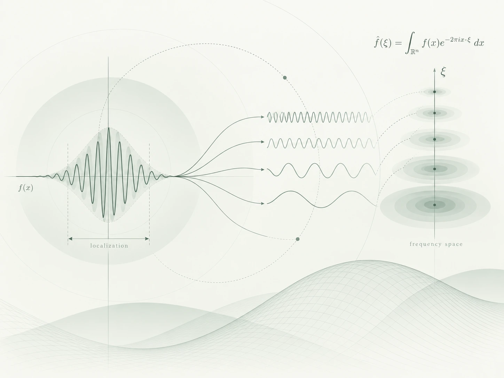

::: {.page-breadcrumb}
[Home](index.qmd) / Mathematical Notes / Harmonic Analysis
:::

::: {.notebook-hero}
::: {.hero-copy}
::: {.eyebrow}
MATHEMATICAL NOTES · HARMONIC ANALYSIS
:::

# Harmonic Analysis {.hero-title}

Exploring different ways to understand functions through frequency, oscillation, and scale. These notes on Fourier analysis and related topics begin with the intuition behind basic concepts and develop toward more detailed arguments.

[Start with the geometry of frequency →](essays/fourier-frequency-geometry-1.qmd){.reading-link}
:::

::: {.hero-figure}

:::
:::

::: {.section-kicker}
## Articles & Notes

From an intuition to a clear explanation.
:::

::: {#essays}
:::

::: {.series-note}
::: {.eyebrow}
READING SERIES
:::

### The Geometry of Frequency

Starting with a single Fourier atom, explore how frequency describes direction, variation, and spatial scale.

[Read the series →](series.qmd){.reading-link}
:::
