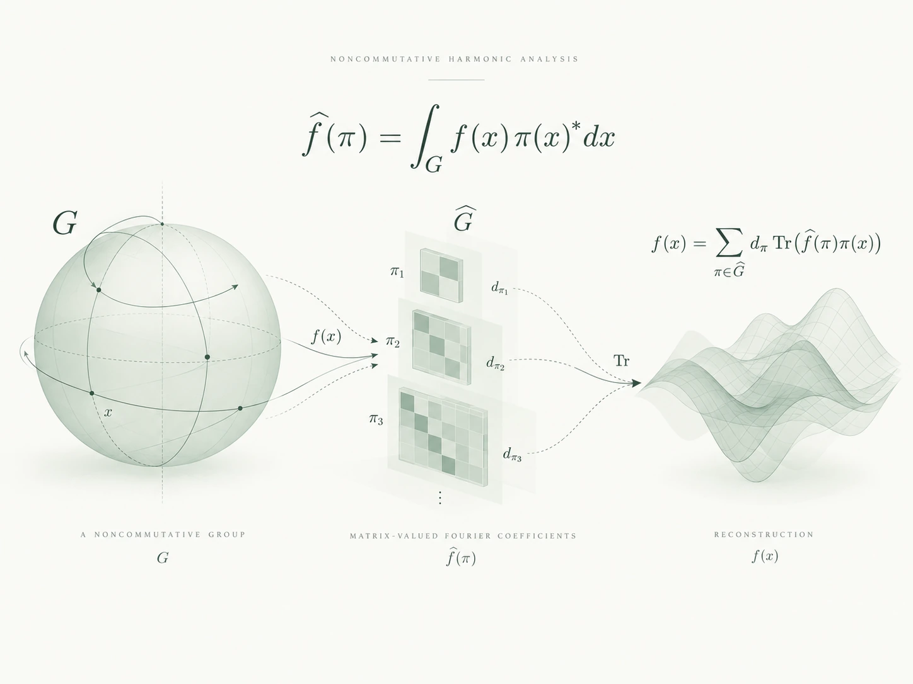
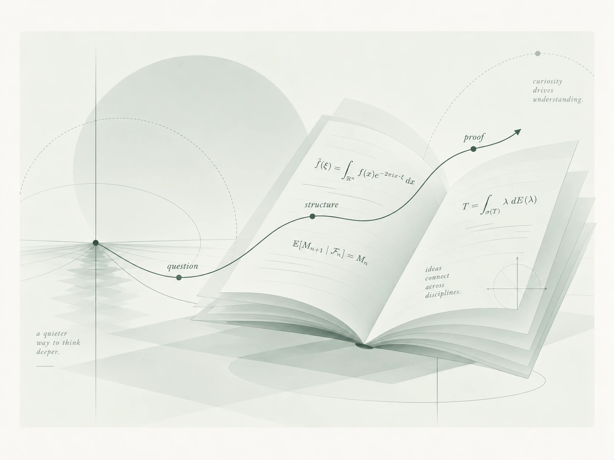

::: {.notebook-hero}
::: {.hero-copy}
```{=html}
<div class="site-byline">
<span class="byline-credit"><span class="byline-label">AN OPEN NOTEBOOK BY</span> <strong class="byline-name">Tian</strong></span>
<a class="byline-social" href="https://x.com/tianmathmath" target="_blank" rel="me noopener noreferrer" aria-label="Tian on X, @tianmathmath (opens in a new tab)">X · @tianmathmath <span aria-hidden="true">↗</span></a>
</div>
```

# Starting with mathematics,<br>writing thoughts down. {.hero-title}

Here I share my mathematical notes, reflections, and essays: from the intuition behind a concept to the details of a proof, from questions found in books to thoughts beyond mathematics. Understanding and writing, a little at a time.

[Browse mathematical notes ↓](#mathematical-notes){.reading-link}
:::

::: {.hero-figure}

:::
:::

::: {.section-kicker}
## Mathematical Notes {#mathematical-notes}

Exploring the connections between different branches of mathematics.
:::

::: {.topic-grid}
::: {.topic-card}
::: {.eyebrow}
01 · HARMONIC ANALYSIS
:::

### [Harmonic Analysis](harmonic-analysis.qmd)

Exploring the structure of functions and the geometric intuition of Fourier analysis through frequency, oscillation, and scale.

[Explore harmonic analysis →](harmonic-analysis.qmd){.reading-link}
:::

::: {.topic-card}
::: {.eyebrow}
02 · MARTINGALE THEORY
:::

### [Martingale Theory](martingales.qmd)

Notes on conditional expectation, martingales, and stopping times, covering basic concepts, convergence, and inequalities in stochastic processes.

[Explore martingale theory →](martingales.qmd){.reading-link}
:::

::: {.topic-card}
::: {.eyebrow}
03 · OPERATOR ALGEBRAS
:::

### [Operator Algebras](operator-algebras.qmd)

Exploring the language and examples of C* algebras and von Neumann algebras, starting with operators on Hilbert spaces.

[Explore operator algebras →](operator-algebras.qmd){.reading-link}
:::

::: {.topic-card}
::: {.eyebrow}
04 · FUNCTIONAL ANALYSIS
:::

### [Functional Analysis](functional-analysis.qmd)

Notes on normed spaces, linear operators, and duality, with an emphasis on concrete understanding behind abstract structures.

[Explore functional analysis →](functional-analysis.qmd){.reading-link}
:::

:::

:::: {.series-note .personal-note}
::: {.personal-copy}
::: {.eyebrow}
BEYOND MATHEMATICS
:::

## Reflections & Essays

A place for thoughts that need not become theorems: reflections on reading, everyday observations, and questions still taking shape.

[Explore reflections and essays →](personal.qmd){.reading-link}
:::

<div class="personal-artwork">
<a href="personal.html"></a>
</div>
::::

::: {.section-kicker}
## Latest Updates {#latest-writing}

A little understanding, one entry at a time.
:::

::: {#essays}
:::
