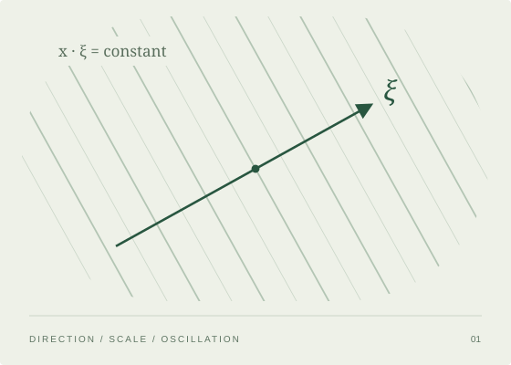

::: {.notebook-hero}
::: {.hero-copy}
::: {.eyebrow}
AN OPEN NOTEBOOK · BY TIAN
:::

# 从数学出发， 把思考写下来。 {.hero-title}

这里收录我的数学笔记、杂谈与随笔。从一个概念的直觉，到一段证明的细节；从书页间的问题，到数学之外的思考。慢慢理解，也慢慢记录。

[浏览数学笔记 ↓](#mathematical-notes){.reading-link}
:::

::: {.hero-figure}
{width=560 height=400}
:::
:::

::: {.section-kicker}
## 数学笔记 {#mathematical-notes}

沿着不同的方向，理解彼此相连的数学。
:::

::: {.topic-grid}
::: {.topic-card}
::: {.eyebrow}
01 · HARMONIC ANALYSIS
:::

### [调和分析](harmonic-analysis.qmd)

从频率、振荡与尺度出发，理解函数的结构，以及傅里叶分析中的几何直觉。

[进入调和分析 →](harmonic-analysis.qmd){.reading-link}
:::

::: {.topic-card}
::: {.eyebrow}
02 · MARTINGALE THEORY
:::

### [鞅论](martingales.qmd)

围绕条件期望、鞅与停时，记录随机过程中的基本概念、收敛与不等式。

[进入鞅论 →](martingales.qmd){.reading-link}
:::

::: {.topic-card}
::: {.eyebrow}
03 · OPERATOR ALGEBRAS
:::

### [算子代数](operator-algebras.qmd)

从 Hilbert 空间上的算子出发，梳理 C* 代数与 von Neumann 代数的语言和例子。

[进入算子代数 →](operator-algebras.qmd){.reading-link}
:::

::: {.topic-card}
::: {.eyebrow}
04 · FUNCTIONAL ANALYSIS
:::

### [泛函分析](functional-analysis.qmd)

关于赋范空间、线性算子与对偶性的笔记，关注抽象结构背后的具体理解。

[进入泛函分析 →](functional-analysis.qmd){.reading-link}
:::

:::

::: {.series-note .personal-note}
::: {.eyebrow}
BEYOND MATHEMATICS
:::

## 杂谈与随笔

给不必写成定理的想法留一个地方：阅读中的感受、日常的观察，以及尚未成形的问题。

[走进杂谈与随笔 →](personal.qmd){.reading-link}
:::

::: {.section-kicker}
## 最近更新 {#latest-writing}

每次记下一点理解。
:::

::: {#essays}
:::
