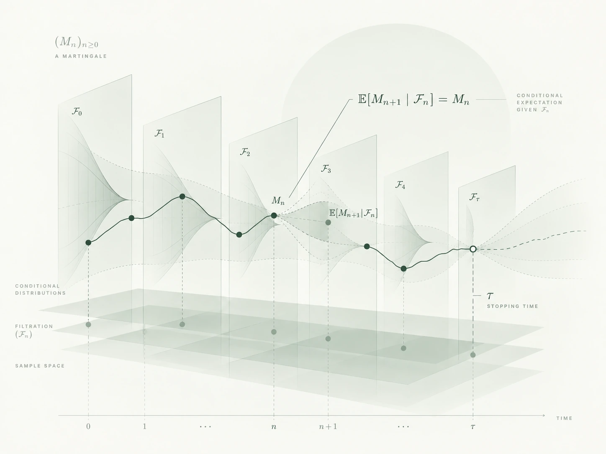

::: {.page-breadcrumb}
[Home](index.qmd) / Mathematical Notes / Martingale Theory
:::

Notes on conditional expectation, martingales, and stopping times, covering basic concepts, convergence, and inequalities in stochastic processes.

::: {.empty-note}
Notes will be added here over time.
:::

## Articles & Notes

::: {#essays}
:::

[Return home to explore other topics →](index.qmd#mathematical-notes){.reading-link}
