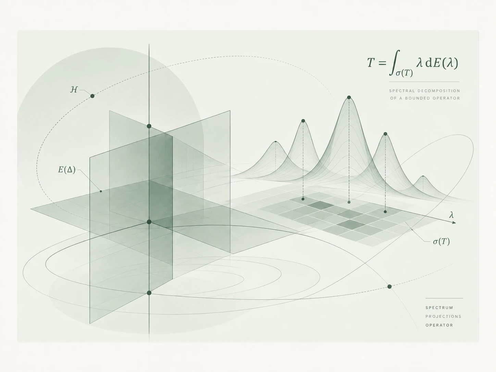

::: {.page-breadcrumb}
[Home](index.qmd) / Mathematical Notes / Operator Algebras
:::

Exploring the language and examples of C* algebras and von Neumann algebras, starting with operators on Hilbert spaces.

::: {.empty-note}
Notes will be added here over time.
:::

## Articles & Notes

::: {#essays}
:::

[Return home to explore other topics →](index.qmd#mathematical-notes){.reading-link}
